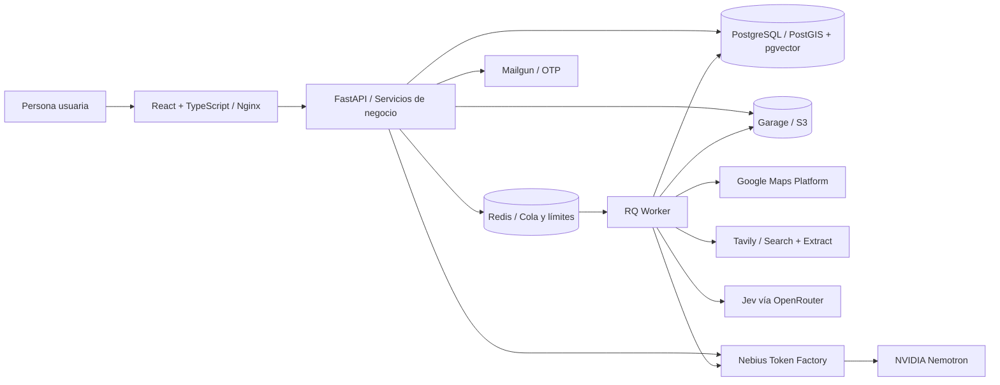

# Agent Sales

### Prospección comercial con evidencia y revisión humana

**De una búsqueda de negocios a una conversación informada, con seguimiento por lead.**

Agent Sales conecta descubrimiento en Google Maps, investigación con Tavily, evaluación explicable con Jev y preparación de contactos con NVIDIA Nemotron servido por Nebius Token Factory, dentro de un CRM con revisión humana. La demo del hackatón utiliza **Tu Web MX** como negocio de ejemplo: cada participante revisa su contexto, aprueba las condiciones y decide cómo continuar con cada prospecto.

[Abrir demo](https://tuwebmx.anuarbarrera.dev) · [Recorrido](#recorrido-de-la-demo) · [Arquitectura](#arquitectura) · [Despliegue](#despliegue-con-docker-compose)

## El problema

Encontrar negocios es sólo el inicio de la prospección. La información puede estar incompleta, una URL puede pertenecer a un directorio y una necesidad aparente puede no estar confirmada. Convertir esas señales en mensajes sin revisar su procedencia produce contactos poco pertinentes y conversaciones difíciles de retomar.

Agent Sales conecta las decisiones con la evidencia disponible y mantiene a la persona al mando del contacto comercial.

## Recorrido de la demo

1. **Acceder con correo y código OTP.** Cada participante obtiene un espacio de trabajo propio.
2. **Revisar el negocio y su contexto comercial.** Aprobar oferta, perfil objetivo, señales, exclusiones y canales permitidos.
3. **Descubrir y enriquecer negocios.** Seleccionar giro y zona en Maps; el worker incorpora evidencia web mediante Tavily antes de evaluar las condiciones con Jev.
4. **Revisar resultados y fuentes.** Consultar identidad, contacto, condiciones evaluadas, evidencia y preguntas pendientes.
5. **Preparar y aprobar un borrador.** Elegir correo o pitch de llamada según los canales disponibles. El texto requiere revisión humana antes de quedar listo para uso manual.
6. **Consultar a Nemotron.** Elegir hasta dos leads por participante y pulsar «Sugerir con IA». Nebius Token Factory genera una revisión breve, preguntas pendientes y un próximo paso a partir del contexto aprobado y hasta tres fuentes. La sugerencia no modifica la clasificación ni autoriza el contacto.
7. **Dar seguimiento.** Registrar el contacto realizado y su resultado, guardar notas, programar tareas, completarlas y consultar el historial del lead.

La demo permite **dos búsquedas por correo verificado**, con **hasta tres candidatos por búsqueda** y un borrador por lead. Son límites de uso: Maps y la evidencia disponible pueden producir menos resultados. La aplicación registra aprobaciones y seguimiento; el contacto se realiza manualmente. Las sugerencias de IA tienen **dos intentos por participante y uno por lead**, con un máximo de **2048 tokens de salida por intento**. Se reservan en PostgreSQL antes de llamar a Nebius; los fallos también consumen el intento y no hay reintentos automáticos. Volver a abrir una sugerencia consulta el resultado guardado sin inferencia adicional.

## Arquitectura

Un **monolito modular con un worker independiente** concentra las reglas de negocio en el backend y separa las operaciones de descubrimiento y evaluación del ciclo HTTP. PostgreSQL conserva el estado durable; Redis coordina la cola y los controles temporales.



| Capa | Tecnología | Responsabilidad |
| --- | --- | --- |
| Interfaz | React, TypeScript, Tailwind CSS, MapLibre | Mapa, revisión de condiciones, fichas de evidencia y seguimiento |
| Entrega web | Nginx | Bundle compilado, rutas SPA y proxy de `/api/` |
| API | FastAPI, Pydantic, SQLAlchemy | Contratos, permisos, aislamiento por workspace y transacciones |
| Procesamiento | RQ, Redis | Ejecución de búsquedas y evaluaciones en segundo plano |
| Persistencia | PostgreSQL, PostGIS, pgvector, Alembic | Leads, evidencia, cuotas, aprobaciones, tareas y migraciones |
| Archivos | Garage, API compatible con S3 | Documentos y archivos del CRM |
| Descubrimiento y fuentes | Google Maps, Tavily Search + Extract | Negocios candidatos y evidencia web trazable |
| Evaluación | Jev vía OpenRouter | Juicios estructurados sobre las condiciones comerciales |
| Inferencia y generación | Nebius Token Factory, NVIDIA Nemotron | Interpretación y borradores sujetos a contratos y revisión humana |
| Correo de acceso | Mailgun | Entrega de códigos OTP |

Identidad, prospección, contexto comercial, evaluación, borradores y actividades tienen responsabilidades y contratos explícitos. Los proveedores se configuran en el servidor; cada operación conserva los controles de acceso, presupuesto y evidencia de su módulo.

## IA y fuentes: el papel de cada tecnología

| Tecnología | Papel en el proyecto | Resultado que aporta |
| --- | --- | --- |
| **Tavily** | Buscar información pública y extraer contenido de una URL seleccionada | Fuentes con URL, fragmentos y metadatos que pueden revisarse y vincularse al negocio |
| **Jev** | Evaluar condiciones comerciales sobre la evidencia disponible | Juicios estructurados, razones y condiciones que siguen sin establecerse |
| **Nebius Token Factory** | Servir inferencia mediante una API compatible con OpenAI | Acceso al modelo configurado, con límites de tiempo y registro de proveedor, modelo, consumo y latencia |
| **NVIDIA Nemotron** | Interpretar evidencia y generar respuestas estructuradas en los flujos de análisis y Setter que usan el modelo configurado en Nebius | Interpretación comercial y borradores de primer contacto vinculados al contexto aprobado |

**Del descubrimiento a la evidencia.** Maps aporta los candidatos y sus datos iniciales. La búsqueda de la demo solicita un enriquecimiento acotado con Tavily antes de Jev: hasta una búsqueda, una extracción cuando hay una URL elegible y un máximo de tres fuentes seleccionadas por candidato. Se conserva la procedencia; encontrar una página no prueba por sí solo que pertenezca al negocio. La investigación manual adicional permanece fuera de la superficie pública.

**De la evidencia al borrador.** Nebius es la plataforma de inferencia y Nemotron es el modelo configurado para las rutas que utilizan `NEBIUS_MODEL`; el valor predeterminado del repositorio es `nvidia/nemotron-3-super-120b-a12b`. El CRM integra este proveedor para análisis de prospectos, sugerencias de contexto comercial y generación de Setter. Los contratos validan la estructura de la respuesta y las referencias a evidencia autorizadas.

**Disponibilidad en la demo.** La evaluación Jev y la revisión humana mantienen responsabilidades independientes de la generación. Cuando sólo puede prepararse una pregunta de discovery, Setter utiliza una plantilla determinista que reconoce la oportunidad no confirmada. Los borradores apoyados en una oportunidad establecida utilizan el proveedor Nebius configurado. La aprobación del mensaje y el registro del contacto continúan siendo acciones explícitas de la persona usuaria.

## Decisiones de diseño

- **Evidencia antes que conclusiones.** Identidad del negocio, cumplimiento de condiciones y disponibilidad de contacto se evalúan por separado. Una oportunidad desconocida permanece como dato por confirmar.
- **Juicios explicables.** La ficha presenta razones, fuentes y preguntas pendientes. La cobertura indica cuántas condiciones tienen evidencia; no representa una probabilidad de venta.
- **Aprobación de una versión concreta.** El servidor verifica contenido, digest y vigencia del contexto, y registra actor y fecha de la decisión.
- **Acciones explícitas e idempotentes.** Cuotas y reservas de ejecución son durables. Reintentar una intención no concede búsquedas adicionales ni duplica actividades o tareas.
- **Aislamiento por workspace.** Los accesos y las escrituras se validan en el servidor. La demo expone una lista delimitada de operaciones permitidas.
- **Seguimiento coherente.** Se conserva la primera fecha de contacto. La próxima fecha corresponde a la tarea activa más cercana y se limpia al completar la última.
- **Interfaz orientada a decidir.** Resultados, preguntas pendientes y siguiente acción se presentan juntos. Los fallos técnicos se distinguen de una conclusión comercial.
- **Despliegue reproducible.** API, worker y frontend ejecutan imágenes construidas. La identidad de build permite contrastar el código desplegado con su revisión.

## Despliegue con Docker Compose

Requisitos: Docker Engine, Docker Compose v2, Git y credenciales de los proveedores que se habiliten.

```bash
git clone https://github.com/AnuarBarrera/Agent-sales.git
cd Agent-sales
cp .env.example .env
```

Completa `.env` antes de iniciar. Configura un `SECRET_KEY` propio; puedes generar una clave con `openssl rand -hex 32`. El archivo privado `.env` queda excluido de Git y de los contextos de construcción.

```bash
export APP_BUILD_REVISION="$(git rev-parse HEAD)"
docker compose config --quiet
docker compose up -d --build
docker compose ps
curl --fail http://127.0.0.1:5173/api/v1/health
```

Compose inicia **PostgreSQL, Redis, Garage, API, worker y frontend**. La API aplica las migraciones con Alembic al arrancar. Los datos se mantienen en volúmenes nombrados.

| Servicio | Dirección local |
| --- | --- |
| Interfaz | `http://127.0.0.1:5173` |
| API | `http://127.0.0.1:8001/api/v1` |
| OpenAPI | `http://127.0.0.1:8001/api/v1/docs` |
| PostgreSQL | `127.0.0.1:5434` |
| Redis | `127.0.0.1:6380` |
| Garage S3 | `127.0.0.1:3900` |

### Habilitar el recorrido público

El acceso público está deshabilitado por defecto. Para activar OTP, Maps, enriquecimiento y evaluación, y habilitar los flujos de generación con modelo, configura:

| Grupo | Variables |
| --- | --- |
| Acceso público | `DEMO_PUBLIC_MODE=true`, `DEMO_PUBLIC_ORIGIN=https://tu-dominio.example` |
| Sesión | `COOKIE_SECURE=true`, `COOKIE_SAMESITE=lax`, `CORS_ORIGINS` con el origen HTTPS exacto |
| OTP | `DEMO_OTP_HMAC_KEY` de al menos 32 bytes |
| Entrega de correo | `MAILGUN_API_KEY`, `MAILGUN_DOMAIN`, `MAILGUN_SENDER_EMAIL`, `MAILGUN_REGION` |
| Maps | `GOOGLE_PLACES_API_KEY`, `GOOGLE_GEOCODING_API_KEY` |
| Investigación web | `TAVILY_ENABLED=true`, `TAVILY_API_KEY`, `TAVILY_TIMEOUT_SECONDS` |
| Evaluación | `LEAD_FIT_ENABLED=true`, `JEV_ENABLED=true`, `OPENROUTER_API_KEY` |
| Inferencia Nebius | `NEBIUS_ENABLED=true`, `NEBIUS_API_KEY`, `NEBIUS_BASE_URL=https://api.tokenfactory.nebius.com/v1` |
| Modelo Nemotron | `NEBIUS_MODEL=nvidia/nemotron-3-super-120b-a12b`; `NEBIUS_TIMEOUT_SECONDS` y, si corresponde, `NEBIUS_AI_PROJECT_ID` |
| Capacidad global | `DEMO_GLOBAL_SEARCH_LIMIT`, con valor inicial de `40` |

Publica el frontend detrás de un proxy o túnel HTTPS. El origen de la demo y el de CORS deben coincidir con ese dominio. Las credenciales deben tener habilitados los servicios y remitentes correspondientes. Las claves de correo y OTP se entregan sólo a la API.

El Compose incluido es una base de demo con puertos en loopback y credenciales de infraestructura de desarrollo. Para un entorno público propio, configura credenciales de infraestructura independientes, HTTPS y respaldos según tu operación.

### Actualizar una versión

```bash
git pull --ff-only
export APP_BUILD_REVISION="$(git rev-parse HEAD)"
docker compose up -d --build --no-deps api worker frontend
docker compose logs --tail=50 api worker
curl --fail http://127.0.0.1:5173/api/v1/health
```

Los cambios de código se publican reconstruyendo las imágenes. Los volúmenes de datos se conservan durante la actualización.

## Estructura de la entrega

```text
.
├── backend/
│   ├── app/                 # API, módulos de negocio, integraciones y worker
│   ├── migrations/          # Evolución del esquema con Alembic
│   ├── Dockerfile
│   └── pyproject.toml
├── frontend/
│   ├── src/                 # Pantallas y componentes
│   ├── nginx.conf           # Servidor estático y proxy
│   ├── Dockerfile
│   └── package-lock.json
├── docker-compose.yml
├── garage.toml
└── .env.example
```

Agent Sales ayuda a investigar, revisar y organizar conversaciones comerciales. La evidencia disponible orienta la decisión; la intención de compra y los resultados comerciales requieren validación en una conversación real.

## Licencia

Este proyecto se distribuye bajo la licencia [Apache License 2.0](LICENSE).
