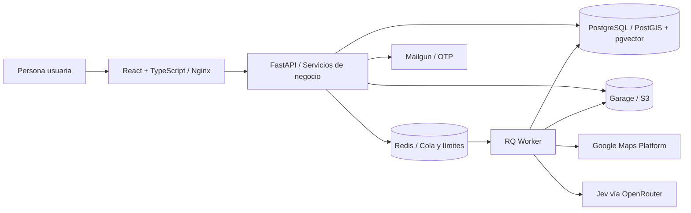

# Agent Sales

### Prospección comercial con evidencia y revisión humana

**De una búsqueda de negocios a una conversación informada, con seguimiento por lead.**

Agent Sales conecta descubrimiento en Google Maps, evaluación explicable de condiciones comerciales y preparación de primeros contactos en un CRM. La demo del hackatón utiliza **Tu Web MX** como negocio de ejemplo: cada participante revisa su contexto, aprueba las condiciones y decide cómo continuar con cada prospecto.

[Abrir demo](https://tuwebmx.anuarbarrera.dev) · [Recorrido](#recorrido-de-la-demo) · [Arquitectura](#arquitectura) · [Despliegue](#despliegue-con-docker-compose)

## El problema

Encontrar negocios es sólo el inicio de la prospección. La información puede estar incompleta, una URL puede pertenecer a un directorio y una necesidad aparente puede no estar confirmada. Convertir esas señales en mensajes sin revisar su procedencia produce contactos poco pertinentes y conversaciones difíciles de retomar.

Agent Sales conecta las decisiones con la evidencia disponible y mantiene a la persona al mando del contacto comercial.

## Recorrido de la demo

1. **Acceder con correo y código OTP.** Cada participante obtiene un espacio de trabajo propio.
2. **Revisar el negocio y su contexto comercial.** Aprobar oferta, perfil objetivo, señales, exclusiones y canales permitidos.
3. **Buscar negocios en Maps.** Seleccionar giro y zona en un mapa; la búsqueda se procesa en segundo plano.
4. **Revisar resultados y fuentes.** Consultar identidad, contacto, condiciones evaluadas, evidencia y preguntas pendientes.
5. **Preparar y aprobar un borrador.** Elegir correo o pitch de llamada según los canales disponibles. El texto requiere revisión humana antes de quedar listo para uso manual.
6. **Dar seguimiento.** Registrar el contacto realizado y su resultado, guardar notas, programar tareas, completarlas y consultar el historial del lead.

La demo permite **dos búsquedas por correo verificado**, con **hasta tres candidatos por búsqueda** y un borrador por lead. Son límites de uso: Maps y la evidencia disponible pueden producir menos resultados. La aplicación registra aprobaciones y seguimiento; el contacto se realiza manualmente.

## Arquitectura

Un **monolito modular con un worker independiente** concentra las reglas de negocio en el backend y separa las operaciones de descubrimiento y evaluación del ciclo HTTP. PostgreSQL conserva el estado durable; Redis coordina la cola y los controles temporales.



| Capa | Tecnología | Responsabilidad |
| --- | --- | --- |
| Interfaz | React, TypeScript, Tailwind CSS, MapLibre | Mapa, revisión de condiciones, fichas de evidencia y seguimiento |
| Entrega web | Nginx | Bundle compilado, rutas SPA y proxy de `/api/` |
| API | FastAPI, Pydantic, SQLAlchemy | Contratos, permisos, aislamiento por workspace y transacciones |
| Procesamiento | RQ, Redis | Ejecución de búsquedas y evaluaciones en segundo plano |
| Persistencia | PostgreSQL, PostGIS, pgvector, Alembic | Leads, evidencia, cuotas, aprobaciones, tareas y migraciones |
| Archivos | Garage, API compatible con S3 | Documentos y archivos del CRM |
| Integraciones | Maps, Mailgun, Jev/OpenRouter | Descubrimiento, acceso por correo y evaluación de evidencia |

Identidad, prospección, contexto comercial, evaluación, borradores y actividades tienen responsabilidades y contratos explícitos. Las integraciones adicionales del CRM, como Tavily y los proveedores de generación, se habilitan por configuración; la superficie pública ofrece un conjunto acotado de capacidades.

## Decisiones de diseño

- **Evidencia antes que conclusiones.** Identidad del negocio, cumplimiento de condiciones y disponibilidad de contacto se evalúan por separado. Una oportunidad desconocida permanece como dato por confirmar.
- **Juicios explicables.** La ficha presenta razones, fuentes y preguntas pendientes. La cobertura indica cuántas condiciones tienen evidencia; no representa una probabilidad de venta.
- **Aprobación de una versión concreta.** El servidor verifica contenido, digest y vigencia del contexto, y registra actor y fecha de la decisión.
- **Acciones explícitas e idempotentes.** Cuotas y reservas de ejecución son durables. Reintentar una intención no concede búsquedas adicionales ni duplica actividades o tareas.
- **Aislamiento por workspace.** Los accesos y las escrituras se validan en el servidor. La demo expone una lista delimitada de operaciones permitidas.
- **Seguimiento coherente.** Se conserva la primera fecha de contacto. La próxima fecha corresponde a la tarea activa más cercana y se limpia al completar la última.
- **Interfaz orientada a decidir.** Resultados, preguntas pendientes y siguiente acción se presentan juntos. Los fallos técnicos se distinguen de una conclusión comercial.
- **Despliegue reproducible.** API, worker y frontend ejecutan imágenes construidas. La identidad de build permite contrastar el código desplegado con su revisión.

## Despliegue con Docker Compose

Requisitos: Docker Engine, Docker Compose v2, Git y credenciales de los proveedores que se habiliten.

```bash
git clone https://github.com/AnuarBarrera/Agent-sales.git
cd Agent-sales
cp .env.example .env
```

Completa `.env` antes de iniciar. Configura un `SECRET_KEY` propio; puedes generar una clave con `openssl rand -hex 32`. El archivo privado `.env` queda excluido de Git y de los contextos de construcción.

```bash
export APP_BUILD_REVISION="$(git rev-parse HEAD)"
docker compose config --quiet
docker compose up -d --build
docker compose ps
curl --fail http://127.0.0.1:5173/api/v1/health
```

Compose inicia **PostgreSQL, Redis, Garage, API, worker y frontend**. La API aplica las migraciones con Alembic al arrancar. Los datos se mantienen en volúmenes nombrados.

| Servicio | Dirección local |
| --- | --- |
| Interfaz | `http://127.0.0.1:5173` |
| API | `http://127.0.0.1:8001/api/v1` |
| OpenAPI | `http://127.0.0.1:8001/api/v1/docs` |
| PostgreSQL | `127.0.0.1:5434` |
| Redis | `127.0.0.1:6380` |
| Garage S3 | `127.0.0.1:3900` |

### Habilitar el recorrido público

El acceso público está deshabilitado por defecto. Para activar OTP, Maps y evaluación, configura:

| Grupo | Variables |
| --- | --- |
| Acceso público | `DEMO_PUBLIC_MODE=true`, `DEMO_PUBLIC_ORIGIN=https://tu-dominio.example` |
| Sesión | `COOKIE_SECURE=true`, `COOKIE_SAMESITE=lax`, `CORS_ORIGINS` con el origen HTTPS exacto |
| OTP | `DEMO_OTP_HMAC_KEY` de al menos 32 bytes |
| Entrega de correo | `MAILGUN_API_KEY`, `MAILGUN_DOMAIN`, `MAILGUN_SENDER_EMAIL`, `MAILGUN_REGION` |
| Maps | `GOOGLE_PLACES_API_KEY`, `GOOGLE_GEOCODING_API_KEY` |
| Evaluación | `LEAD_FIT_ENABLED=true`, `JEV_ENABLED=true`, `OPENROUTER_API_KEY` |
| Capacidad global | `DEMO_GLOBAL_SEARCH_LIMIT`, con valor inicial de `40` |

Publica el frontend detrás de un proxy o túnel HTTPS. El origen de la demo y el de CORS deben coincidir con ese dominio. Las credenciales deben tener habilitados los servicios y remitentes correspondientes. Las claves de correo y OTP se entregan sólo a la API.

El Compose incluido es una base de demo con puertos en loopback y credenciales de infraestructura de desarrollo. Para un entorno público propio, configura credenciales de infraestructura independientes, HTTPS y respaldos según tu operación.

### Actualizar una versión

```bash
git pull --ff-only
export APP_BUILD_REVISION="$(git rev-parse HEAD)"
docker compose up -d --build --no-deps api worker frontend
docker compose logs --tail=50 api worker
curl --fail http://127.0.0.1:5173/api/v1/health
```

Los cambios de código se publican reconstruyendo las imágenes. Los volúmenes de datos se conservan durante la actualización.

## Estructura de la entrega

```text
.
├── backend/
│   ├── app/                 # API, módulos de negocio, integraciones y worker
│   ├── migrations/          # Evolución del esquema con Alembic
│   ├── Dockerfile
│   └── pyproject.toml
├── frontend/
│   ├── src/                 # Pantallas y componentes
│   ├── nginx.conf           # Servidor estático y proxy
│   ├── Dockerfile
│   └── package-lock.json
├── docker-compose.yml
├── garage.toml
└── .env.example
```

Agent Sales ayuda a investigar, revisar y organizar conversaciones comerciales. La evidencia disponible orienta la decisión; la intención de compra y los resultados comerciales requieren validación en una conversación real.
